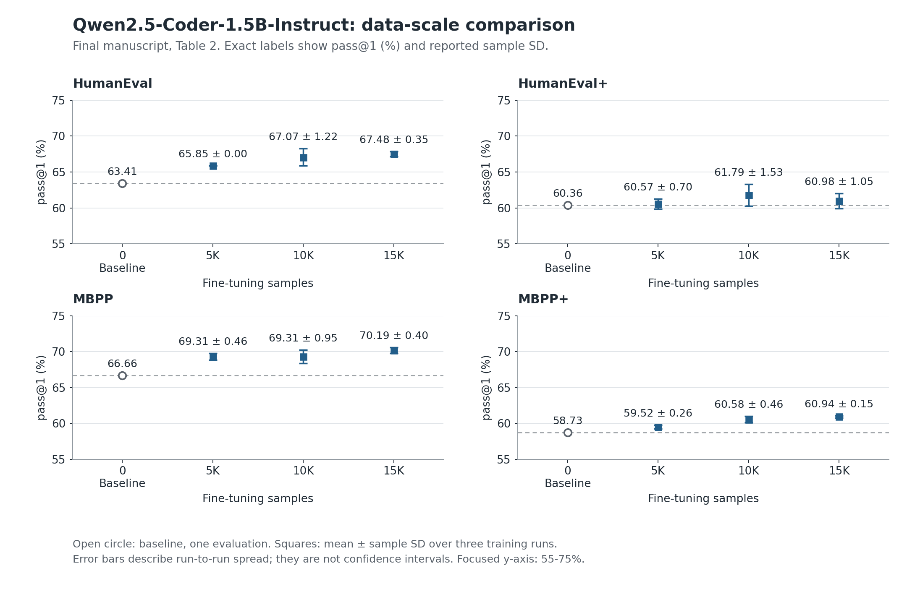
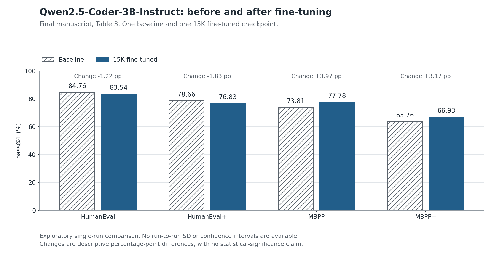

# Qwen2.5-Coder Research Companion

**Does additional instruction fine-tuning improve an already instruction-tuned code model across task formats?** This companion presents the reported Python code-generation experiments from *Understanding instruction fine-tuning for code generation models: A study on Qwen2.5-Coder*, by Pan Xu.

The contribution is an empirical comparison across data budgets, training runs, benchmark families, and test strictness. It introduces no new training algorithm. This repository provides inspectable results, figures, and evidence boundaries. Its executable scope is **summary-level analysis and figure regeneration**; historical training and model evaluation cannot currently be replayed.

## Experimental design

- **Main study:** Qwen2.5-Coder-1.5B-Instruct at baseline and 5K/10K/15K Magicoder-style Python samples. Each fine-tuned budget is reported as mean ± sample SD over three training runs. The baseline is one greedy-decoding evaluation.
- **Exploratory comparison:** Qwen2.5-Coder-3B-Instruct at baseline and after one 15K fine-tuning run. No repeated-run uncertainty is available.
- **Reported method:** LLaMA-Factory LoRA SFT, rank 16, all target modules, two epochs, learning rate 2e-5, sequence length 2,048, and bf16. Full reported settings are transcribed in [Table 1](evidence/paper_table_1.csv).
- **Reported evaluation:** one greedy solution per task, EvalPlus sanitization and common-import patching, then executable pass@1 on HumanEval, HumanEval+, MBPP, and MBPP+. These pipeline details are manuscript statements; the original evaluation scripts are missing.

## Main findings

Changes below use the **final manuscript's Tables 2 and 3**. Units are percentage points (pp). For 1.5B, the comparison is the 15K mean against a single baseline; for 3B, both entries are single evaluations.

| Benchmark | 1.5B, 15K change (pp) | 3B, 15K change (pp) |
| --- | ---: | ---: |
| HumanEval | +4.07 | -1.22 |
| HumanEval+ | +0.62 | -1.83 |
| MBPP | +3.53 | +3.97 |
| MBPP+ | +2.21 | +3.17 |



The 1.5B 15K means exceed baseline on all four benchmarks, but the trajectory is task-dependent. HumanEval+ peaks at 10K (61.79 ± 1.53), then decreases at 15K (60.98 ± 1.05). The study does not identify a statistically optimal budget.



The exploratory 3B comparison shows MBPP-family increases alongside HumanEval-family decreases. Task alignment is a possible explanation, not an established causal mechanism. No aggregate benchmark score is used.

## Limitations and evidence

Three 1.5B runs provide a limited description of variability; the reported SDs are not confidence intervals. The 3B experiment cannot establish a data-scale trend. Data amount and realized data composition are not disentangled. No decontamination audit was performed, so benchmark overlap remains an unmeasured risk.

Checkpoints, complete original training configurations, original evaluation/patch scripts, per-seed scores, and sampling records are unavailable. Accordingly, this companion claims no full training reproduction, independent model-score verification, statistical significance, or contamination-free results.

The [provenance record](provenance.md) separates **E1 historical user-provided evidence**, **E3 manuscript summaries**, **E4 historical assistant proposals**, and **post-hoc repository artifacts**. Early screenshot values are kept separate and do not supply either chart. The full audit package and private manuscript are not bundled.

## Inspect and regenerate

Use Python 3.12 in a clean environment. The checked authoring environment used Python 3.12.14 and Matplotlib 3.10.7. The requirements cover this companion's plotting environment only.

```bash
python -m pip install -r requirements.txt
python scripts/check_results.py
python scripts/plot_results.py
python scripts/check_results.py --check-figures
```

Both figures read [paper_results.csv](results/paper_results.csv). [changes_from_baseline.csv](results/changes_from_baseline.csv) contains the derived differences. See the [data dictionary](results/README.md), [actual local checks](validation/local-checks.json), and [review record](validation/review.md).

Read [reproducibility.md](reproducibility.md) for optional private-source checks and the boundary between regenerating figures and reproducing experiments. [citation.md](citation.md) records the verified title and author; conference, publication year, DOI, and formal publication status await confirmation.
